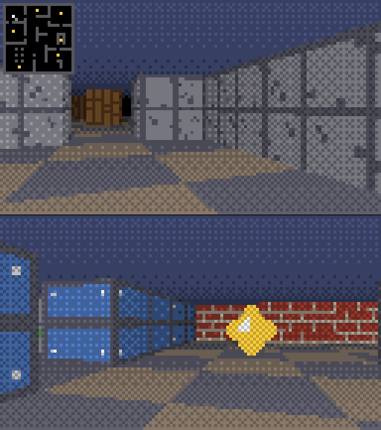

# CellCaster

**A textured 3D raycasting engine that runs inside Excel. Every pixel is a worksheet cell. Pure VBA, no add-ins, no DLLs, no binary assets.**

[Leia em português](README.md)



> The image above is drawn by `tools/reference_renderer.py`, a Python port that is verified to produce exactly the same cells as the VBA. Replace it with a GIF recorded in Excel once you have one.

Walk around a Wolfenstein-style maze, collect the six gems and beat your time, all in a 128 x 72 block of spreadsheet cells.

## Status

Playable, but slow: on the first machine it was tested on (Excel for Windows, 128 x 72 cells) it runs at 2-3 frames per second. The HUD shows how each frame splits between drawing, writing to the sheet and Excel's repaint. Making it faster is the first item on the roadmap. Because of the low frame rate, hold `Esc` for a second to quit.

## Features

- Textured walls with DDA raycasting and fisheye correction
- Floor casting with a checkerboard, and a fogged ceiling
- Distance fog with 4x4 ordered (Bayer) dithering, so 4 shades per colour look like many
- Billboard sprites (the gems) with a per-column z-buffer
- Minimap overlay, HUD with timer and FPS
- Procedural textures: brick, stone, wood, metal and moss are generated by code
- Frame-rate independent movement with wall sliding
- The engine's VBA is tested on Linux in CI, without Excel

## How it renders

Setting `Interior.Color` on 9,216 cells one by one, every frame, is far too slow for a game. CellCaster never touches cell formatting while the game runs:

1. **A palette made of conditional formatting.** At start-up the screen range gets 48 rules of the form "cell value = *n* -> fill colour *n*" (12 colours x 4 shades; 0 stays black).
2. **One write per frame.** The engine fills a 2-D array with palette indices and assigns it to the range in a single `Range.Value2` call. Excel repaints the fills on its own.
3. **Dithering instead of more colours.** A Bayer threshold decides how each cell rounds its brightness, so the palette stays small and the rule count stays low.

## Quick start

Requires Excel for Windows (2010 or later, 32 or 64-bit). The game reads the keyboard through the Windows API, so it does not run on Mac or Excel for the web.

**Option A: build script**

1. In Excel, enable *File > Options > Trust Center > Trust Center Settings > Macro Settings > Trust access to the VBA project object model* (once).
2. Run:
   ```powershell
   powershell -ExecutionPolicy Bypass -File tools\build.ps1
   ```
3. Open the generated `CellCaster.xlsm`, enable macros and press **JOGAR**.

**Option B: by hand**

1. Create a workbook and save it as `.xlsm`.
2. Press `Alt+F11`, then drag the seven files from `src/` into the Project pane (or use *File > Import File*).
3. Press `Alt+F8`, run `InstallMenu`, then press **JOGAR** (or run `StartGame`).

## Controls

| Key | Action |
| --- | --- |
| `W` `S` or `Up` `Down` | Walk |
| `A` `D` | Strafe |
| `Left` `Right` | Turn |
| `M` | Toggle minimap |
| `Esc` | Quit |

## Project layout

| File | Role |
| --- | --- |
| `src/Config.bas` | Every tunable constant and the colour palette |
| `src/World.bas` | Level, player, collisions, gems |
| `src/Textures.bas` | Procedural textures |
| `src/Raycaster.bas` | Floor, walls, sprites and minimap into a frame buffer |
| `src/Renderer.bas` | Worksheet set-up and the one-call blit |
| `src/Platform.bas` | Windows API: keyboard, clock, focus |
| `src/Game.bas` | Main loop, input, menu |
| `tools/build.ps1` | Builds the `.xlsm` from `src/` |
| `tools/reference_renderer.py` | Python port of the renderer, level validator, preview image |
| `tests/` | Runs the real VBA in LibreOffice and compares every cell |

## Make your own level

Edit the `AddRow` lines in `src/World.bas`. `1`-`5` are wall textures, `.` is floor, `P` is the player start and `*` is a gem. The outer ring must be solid. Then check it:

```bash
python tools/reference_renderer.py --check
```

The check fails if a row has the wrong length, the border has a hole or a gem cannot be reached.

## Tests

`Config`, `World`, `Textures` and `Raycaster` contain no Excel or Windows calls, so they run unchanged in LibreOffice Basic's VBA mode. The test suite executes them there, renders several frames and compares all 9,216 cells of each one with the Python reference port, plus a collision walk and the gem pickups.

```bash
python tests/run_vba_tests.py    # needs LibreOffice (soffice) on the PATH
```

`Platform`, `Renderer` and `Game` need Excel on Windows and are not covered by the automated tests.

## Roadmap

- Performance: fewer palette rules, a smaller default screen, partial updates
- Doors and a level exit
- Enemies and a second sprite type
- Mouse look
- An export script to sync edits made in the VBA editor back to `src/`
- A level editor on a worksheet: paint the map with cells

## License

[MIT](LICENSE)
